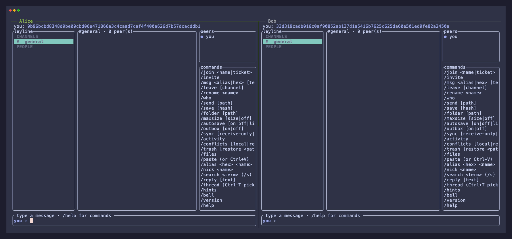
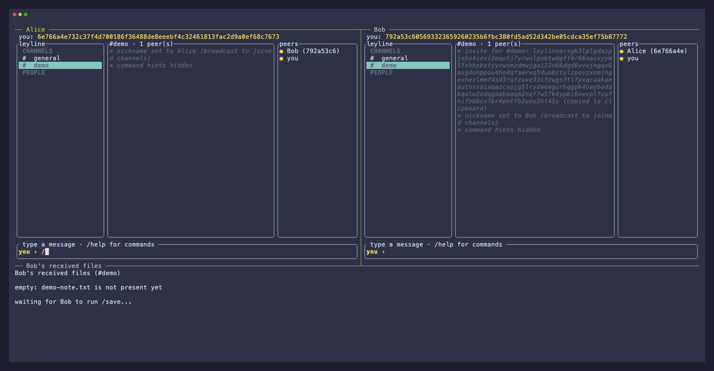

# leyline

**Private chat that lives in your terminal.** leyline lets small groups and
trusted peers talk, share files, and keep channel folders in sync without
accounts, a central chat server, or a relay for your messages.

Create a channel, share its invite with the people you choose, and keep
working. Your identity, channels, messages, and known peers stay on your
device; peers who were offline automatically catch up when they return.


> **[Read the Leyline documentation →](https://jhanekom27.github.io/leyline/)**
> Installation, quickstart, command and keyboard reference, file sharing, and safe folder sync.

## Why leyline

- **Private by default.** Channel names are local labels, not credentials.
  Every channel has its own random secret, carried only in an invite ticket.
- **No accounts or central chat service.** Your local keypair is your
  identity. Messages travel peer-to-peer over
  [iroh](https://github.com/n0-computer/iroh) and iroh-gossip inside a
  [ratatui](https://ratatui.rs) terminal interface.
- **Built for the work around a conversation.** Chat across group channels,
  private messages, or direct peer connections; share files on demand; and
  opt into safe folder sync with conflict copies and recoverable trash.
- **Pick up where you left off.** leyline persists your identity, joined
  channels, and local history, then backfills missed messages for channels
  you are already allowed to join.

## File sharing

Share a local file with `/send <path>`; a peer in the same channel retrieves
the newest shared file with `/save`. The file lands in that channel's own
folder, so unrelated conversations never mix their received files. The
[file-sharing guide](guide/src/file-sharing.md) covers the full workflow.



## 60-second quickstart

Start two local peers and exchange your first message with the
[quickstart guide](https://jhanekom27.github.io/leyline/quickstart.html).
## Install leyline

Download a prebuilt binary or install from a pinned Git tag with Cargo. The
[installation guide](https://jhanekom27.github.io/leyline/installation.html)
covers each supported end-user path, including checksum verification.

## Contributor build & run

Contributors need a recent stable Rust toolchain with edition 2024 support
(Rust 1.91 or newer -- iroh-gossip's current MSRV).

```sh
cargo build --release
cargo run
```

Run `cargo run -- --version` (or `-V`) to print the build's version and
git commit and exit immediately, without touching disk or the network.

On startup, `leyline` prints an invite ticket for each channel it joined
(before the TUI takes over -- just `#general` by default, and private to
this instance alone until you share it) and shows your endpoint id in the
TUI header (`you: <hex id>`). For a working two-instance walkthrough, use
the [60-second quickstart](#60-second-quickstart): it creates a new shared
channel, then uses `/invite` and `/join` to connect the peers.

The ticket bundles the channel's name, its private room secret, and the
sharer's address (including relay/direct-address hints), so pasting it is
enough to connect -- no separate directory service needed, and no one who
only knows (or guesses) the channel's name can join, since the name never
determines the swarm. Connecting still relies on iroh's default relay
servers for NAT traversal, so all instances need outbound internet access.

Once running, join or create additional channels from the message box with
`/join <channel-name-or-ticket>`: a bare name (e.g. `/join project-x`)
creates a brand-new, private channel under that name locally -- share its
ticket with others via `/invite` -- while pasting someone else's ticket
joins their swarm directly.

Every joined channel is listed in the panel down the left, in two
sections: **CHANNELS** for group channels (`#`) and **PEOPLE** for your 1:1
conversations (`@` for a `/msg` DM, `⚡` for a `/dm` point-to-point chat), each in the order you joined them. The active one is highlighted, and another
with unread messages shows its count. Sync-enabled channels show `S`, `~`, `C`, `!`, or `P` for idle, pending, conflict, error, or paused sync; the
panel scrolls once the list is
taller than the terminal. Switch between channels with `Tab` / `Shift+Tab`,
which step down / up the panel and wrap around, or press `Ctrl+P` to jump
straight to one by typing part of its name. Press `Ctrl+K` to browse or filter
slash commands by syntax or description; command-name and alias matches appear
before description-only matches, and `Enter` runs the selected command.

Your identity now persists in your OS config directory, keyed by your `$HOME`.
Chat history persists the same way in your OS data directory -- one log
file per joined channel, so scrollback survives a restart.
Running two instances under the *same* `$HOME` on one machine loads the
*same* identity for both -- and iroh rejects a peer connecting to itself --
so for local multi-instance testing, give each instance its own fake home,
e.g.:

```sh
HOME=/tmp/leyline-a cargo run
HOME=/tmp/leyline-b cargo run
```

...then follow the [60-second quickstart](#60-second-quickstart) to create
and share a `#demo` channel between them.

Each fake `$HOME` also redirects Cargo's own cache, so the first build under
a new one re-fetches and rebuilds every dependency. To avoid that, capture
your real cargo home first and pass it through explicitly:

```sh
REAL_CARGO_HOME="$HOME/.cargo"
HOME=/tmp/leyline-a CARGO_HOME="$REAL_CARGO_HOME" cargo run
HOME=/tmp/leyline-b CARGO_HOME="$REAL_CARGO_HOME" cargo run
```

## Architecture

See [`concept.md`](./concept.md) for the architecture notes: wire format,
the room-privacy model, event loop design, module layout, and the
reasoning behind the network/UI split.
